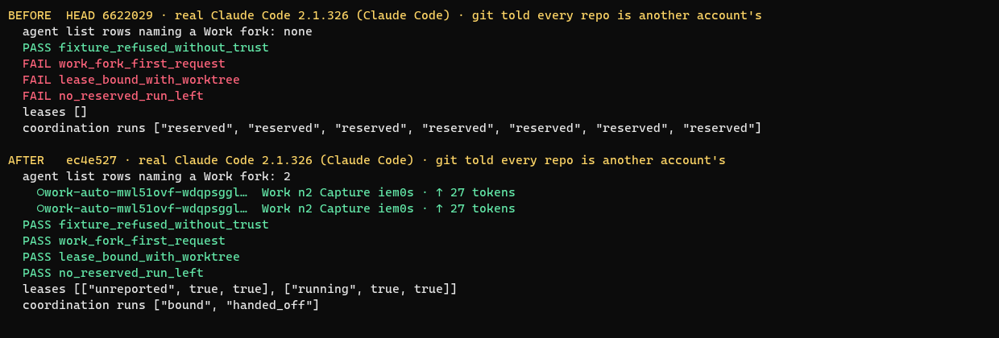

# Request (user, 2026-11-17)

Diagnosis: [../../diagnostics/work-forks-not-spawning/record.md](../../diagnostics/work-forks-not-spawning/record.md).

> 둘다.. 그리고 샌드박스나 또는 기타 독립계정에서 사용되는일이 많은데..왜 권한을 ? 실행자의 권한으로 워크트리를 생성하는데 왜 실패하는거지?? 소유자가 다를수없자나 샌드박스안은 실행자가 소유자인데?

In English: "Both (the runtime fix and the machine setting). This is often used in a sandbox or another separate account. Why does creating a worktree with the runner's own permissions fail? Inside the sandbox the runner is the owner."

# Why the runner's own permissions were not enough

These were measured with git 2.50.0 and `GIT_TEST_ASSUME_DIFFERENT_OWNER=1`, git's own switch for this check.
- **The check is about the repository, not about write permission.** Git compares the owner of the repository directory and `.git` with the current account. On Celly the owner is the machine owner, and the router runs as the sandbox account ([celly-observed.txt](../../diagnostics/work-forks-not-spawning/evidence/celly-observed.txt)). The sandbox account could write the files; git refused before it tried.
- **Command scope is honored.** `git -c safe.directory=<exact root>` passes. Naming the parent folder still fails.
- **A Work worktree is checked on its own.** `worktree add` passes with the source root trusted. A later command run inside the new worktree fails unless the worktree's own exact root is trusted too. A subdirectory of a trusted root passes, because git compares the discovered root.

# Change

1. **Exact trust** (`work_parallel_workspace.trusted_roots`, `trust_arguments`).
   - Every Work git call adds `-c safe.directory=<root>` for at most two roots:
     - the folder the router was launched in (`ROUTER_WORKSPACE`), which the person chose;
     - a Work worktree directly under its `.claude/worktrees` named `work-parallel-<24 hex>`.
   - Any other folder gets no trust and git's normal check, as before. Submodules get none.
   - A wildcard, a relative path or an empty value is refused.
   - `worktree_cleanup.py` takes the same exact roots from its caller.
2. **A failed preparation releases everything it reserved** (`_reserve_assignment`, `_release_failed_reservation`). Nothing has launched yet: the native spawn starts only after reservation returns (P0: after `p0_launch_spawning`).
   - The lease is released (`release_unbound`).
   - The coordination run is cancelled into the archive (`cancel_reserved`).
   - A P0 intent returns from `reserved` to `intent` (`release_reservation`). The next attempt reuses that same intent, so repeated failures add no rows to the 256-row P0 file.
   - A worktree written before the failure stays on disk; it is never reused or removed.
   - One exception is kept: a P0 worktree that was created and verified, where only attaching it to the records failed. That lease stays reserved, and the next P0 pump replays it with the same worktree (existing test `test_workspace_unknown_keeps_p0_reservation_and_intent`).
3. **Failure codes** (`work_parallel_failures.py`).
   - Codes:
     - `workspace_git_untrusted`: git refused ownership.
     - `workspace_prepare_failed`: failed before writing anything.
     - `workspace_prepare_retained`: failed after it began writing.
   - The codes are stored in a new file, `work-parallel-workspace-failures-v1.json`. The existing failure file is shared by every build on the device, and each build refuses a code it does not know.
   - Each code has one server text. The web console, REST, ctl and `/work-mode parallel` show it, and so does the Work pane (one line for the last hour).
   - Git's own message goes only to the router log, as `work_workspace_failed`.
4. **Reconciliation** (`work_parallel_reconcile.py`).
   - It retires:
     - a coordination run still `reserved` with no agent, whose ledger lease is gone;
     - a P0 intent still `reserved` whose lease is gone.
   - Why "gone" is proof:
     - A lease is deleted only while it is an unbound reservation.
     - Lease ids are never reused.
     - The files are read in creation order, so absence is a deletion, not a lease not yet written.
   - Age is never used.
   - A `spawning` or `bound` intent without a lease may have started a fork. It is listed and left unchanged.
   - It runs:
     - on every launch;
     - with the 60-second orphan sweep of a running router.
   - Before any write, the ledger, coordination and P0 files are copied to `work-parallel-backups/<time>` (newest 10 kept).
5. **Operator control.** The orphan preview has a `reconcile` block on every surface, and retiring is pinned to its digest.
   - Menu: `Work 병렬 실행 → orphans`.
   - Web console: `Retire records…` with a confirmation.
   - REST: `parallel-orphans-reconcile`, which needs `confirmed=true`.
   - ctl: `work orphan-reconcile --confirm`.

# Verification

- **Fail-before / pass-after, by behavior** ([foreign-owner-probe.txt](evidence/foreign-owner-probe.txt), [refused-release-probe.txt](evidence/refused-release-probe.txt), script [foreign_owner_probe.py](evidence/foreign_owner_probe.py)).
  - Before (HEAD `6622029`), with a repository owned by another account and the router launched in it:
    - Ordinary lane: 3 attempts are refused and leave 3 `reserved` runs.
    - P0 lane: the lease, run and intent all stay `reserved`.
  - After: both lanes reserve with a worktree present.
  - With the router launched elsewhere, git's refusal stands, and after the fix it leaves nothing reserved:
    - ordinary lane: 0 leases and 0 runs;
    - P0 lane: 0 leases, 0 runs, and one intent back in state `intent`.
- **New tests** (`tests/test_work_parallel_workspace_trust.py`, 15) cover:
  - which roots are trusted;
  - that every git call of a `prepare` carries its exact root;
  - a foreign-owner launch folder going through prepare, bind, idle and remove;
  - a foreign folder elsewhere refused cleanly;
  - release on both lanes;
  - P0 intent reuse;
  - the failure log;
  - reconcile preview, apply, backup and idempotence;
  - a `spawning` intent left unchanged;
  - a live reservation left unchanged;
  - the launch sweep;
  - 1,501 runs retired in one write.
- **Surface tests**: REST reconcile (`test_work_http_orphan_release.py`), menu plus ctl (`test_work_ctl_parity.py`) and the web console markers (`test_work_web_ui.py`). 134 run, 0 failures.
- **Windows, the changed Work modules** (19 modules on the working tree before the commit): 421 run, 1 failure. The failure was the API description missing the new command. It was fixed and rerun with the surface tests.
- **Linux** (python:3.11-slim, git 2.47.3, the same 19 modules on a clean `ec4e527` export): 398 passed, 60 skipped, 0 failed.
- **`claude plugin test ciel-work`**: 103 pass, 0 fail.
- **Real Claude Code 2.1.326 E2E** ([run_foreign_owner_e2e.py](e2e-source/run_foreign_owner_e2e.py); [e2e-before/result.json](evidence/e2e-before/result.json), [e2e-after/result.json](evidence/e2e-after/result.json); rendered frame [e2e-foreign-owner.png](evidence/e2e-foreign-owner.png)).
  - Setup:
    - the packaged ciel-work and ciel-work-gate plugins loaded, with hooks observed;
    - the real Work tools as an owned MCP backend;
    - a scripted Messages stand-in;
    - `GIT_TEST_ASSUME_DIFFERENT_OWNER=1` for the backend and claude.exe;
    - the launch folder is the repository, and the fixture is checked to be refused by git without trust.
  - Before (`6622029`): no Work fork started, and 7 coordination runs were left `reserved`. This is Celly's symptom.
  - After (`ec4e527`): the agent list shows `work-auto-…  Work n2 Capture item`. The lease is bound to that native agent with its worktree under `.claude/worktrees`, and no run is left `reserved`.
  - The scripted model never reports, so the first fork ends `unreported` and the existing stranded recovery starts a second fork. That second fork is the `running` lease and the `handed_off` run.
  - Only owned processes were killed: 0 survivors and 0 overlaps with protected processes. The host token appears 0 times in the evidence.

# Not done here

These need the user's confirmation at the time (managed machine):
- Celly's machine setting: adding the exact repository path to the sandbox account's git `safe.directory`.
- Stopping its router.
- The reconcile preview and apply, then a preview again.
- The restart.

With this build alone, the router's own git calls do not need the machine setting. Celly's own commands outside Work still do.
